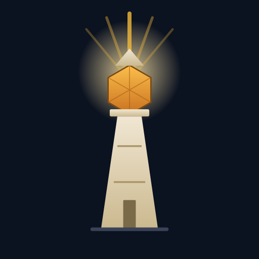

<p align="center">
  
</p>

<h1 align="center">Beacon Table</h1>

<p align="center">
  <b>Виртуальный стол для D&amp;D, когда играете вживую.</b><br>
  Карта на телевизоре, листы персонажей на телефонах,<br>
  а кто не смог прийти — заходит по ссылке.
</p>

<p align="center">
  <a href="https://demo.beacontable.ru/"><b>Демо без регистрации</b></a> ·
  <a href="https://beacontable.ru/download.html">Скачать</a> ·
  <a href="https://beacontable.ru/">Сайт</a> ·
  <a href="https://github.com/major1ink/Beacon-Table/wiki">Вики</a> ·
  <a href="https://t.me/beacontable">Telegram</a> ·
  <a href="#english">English</a>
</p>

<p align="center">
  <a href="https://github.com/major1ink/Beacon-Table/releases/latest"></a>
  
</p>


- **Один файл.** Скачали, запустили — стол открылся в браузере. Без регистрации, подписки и облака.
- **Телевизор без логина.** Показывает только то, что видят персонажи: ни заметок ведущего, ни монстра в засаде.
- **Ноутбук нужен только ведущему.** Игроки — с телефона, удалённые — через интернет в ту же сцену.

**Содержание**

- **Что умеет:** [свет и стены](#свет-упирается-в-стены) · [три экрана](#три-экрана-одной-игры) · [ширма ведущего](#ширма-ведущего) · [бой](#бой) · [журнал и связи](#журнал-и-связи) · [импорт из Foundry](#приключение-из-foundry)
- **Установка:** [какую версию скачать](#какую-версию-скачать) · [сервер](#сервер) · [десктоп](#десктоп) · [модули D&D](#модули-dd) · [Android](#приложение-для-android) · [телевизор](#телевизор)
- [Демо](#попробовать-без-установки) · [Связь](#связь) · [Лицензия](#лицензия) · [English](#english)

## Свет упирается в стены


Стены и двери рисуете мышью прямо по карте. Факел светит до угла, тёмное зрение видит без света, разведанное остаётся в тумане.

## Три экрана одной игры

| Ведущий | Игрок | Телевизор |
| --- | --- | --- |
|  |  |  |
| Вся карта, монстры, музыка, заметки | Свой лист, свой токен, свой свет | Карта во весь экран, без панелей |

## Ширма ведущего


Правила, заметки, случайные таблицы, таймеры и счётчики — в одном окне поверх карты. Вкладку можно открыть игрокам как шпаргалку, таймер видно на телевизоре.

## Бой


Инициатива выстраивается сама, урон падает в лог, состояния отсчитывают раунды и меняют КД и скорость.

## Журнал и связи


Записи — обычные `.md`, у каждой свои права. Связи NPC видны на графе, сессия сама пишется в ленту. Доски в формате Excalidraw открываются и в Obsidian.

## Приключение из Foundry


Ссылка на манифест модуля — и сцены со стенами и светом, существа, журналы и музыка на месте.

## Попробовать без установки

**[Демо-стол](https://demo.beacontable.ru/)** — без регистрации, можно зайти ведущим или игроком. Раз в полчаса сбрасывается.

## Какую версию скачать

Ставит только ведущий. Игрокам и телевизору хватает браузера.

- **Сервер** — один файл без установки, стол открывается в браузере.
- **Десктоп** — тот же стол в своём окне, ставится как обычная программа.

Нужен один из двух. Найдите свою систему: начало имени файла стоит в заголовке столбца, окончание — в строке.

| Ваша система | Сервер<br>`beacon-table_<версия>…` | Десктоп<br>`beacon-table-desktop_<версия>…` |
| --- | --- | --- |
| **Windows** 10 и 11 | `…_windows_amd64.exe` | `…_windows_amd64.exe` |
| **macOS** — любой Mac, M1–M4 и Intel | `…_darwin_universal` | `…_darwin_universal.zip` |
| **Ubuntu, Debian, Mint** | `…_linux_amd64` | `…_linux_amd64.deb` |
| **Fedora, openSUSE** | `…_linux_amd64` | `…_linux_amd64.rpm` |
| **Raspberry Pi** и другой Linux на ARM | `…_linux_arm64` | нет |
| **VPS** с доменом | Docker: `docker compose up -d` | нет |
| **Android** | нет — у игроков [приложение](#приложение-для-android) | нет |
| **iPhone, iPad** | нет — у игроков браузер | нет |

Не знаете, какой у вас Linux? Команда `uname -m`: `x86_64` — берите `amd64`, `aarch64` — `arm64`. Windows на ARM-ноутбуках (Snapdragon) запускает `amd64` сама, через эмуляцию.

Файлы — на [странице скачивания](https://beacontable.ru/download.html) или в [Releases](https://github.com/major1ink/Beacon-Table/releases/latest).

### Сервер

1. Создайте **пустую папку** и положите туда файл: рядом появятся данные стола (`data/`, `uploads/`).
2. Запустите.
   - **Windows** — двойной клик.
   - **Linux и macOS** — в терминале, из этой папки:
     ```bash
     chmod +x beacon-table_*
     ./beacon-table_*
     ```
3. Стол откроется в браузере сам, логин и пароль ведущего уже в форме — нажмите «Войти». Если не открылся: http://localhost:8080.

Окна у сервера нет, он работает в фоне. Выключить — кнопкой питания внизу левой панели у ведущего.

Релизы пока не подписаны сертификатом, поэтому Windows и macOS предупредят о неизвестном издателе. Подлинность файла можно проверить по `checksums.txt` — [как это сделать](https://beacontable.ru/download.html#smartscreen).

### Десктоп

- **Windows** — запустите `.exe`. Нужен WebView2: в Windows 11 он уже есть, в Windows 10 обычно приходит вместе с Edge.
- **macOS** — распакуйте `.zip` и перенесите приложение в «Программы».
- **Ubuntu, Debian, Mint** — `sudo apt install ./beacon-table-desktop_*.deb`
- **Fedora, openSUSE** — `sudo dnf install ./beacon-table-desktop_*.rpm`

При запуске можно поднять стол на этом компьютере или подключиться к столу на сервере. Данные по умолчанию лежат в «Документы/Beacon Table».

### Модули D&D

Программа ставится пустой. D&D 5e (2014 и 2024) и справочник SRD 5.2 ставятся модулями: на экране «Миры» нажмите «Модули» и выберите нужные. Без интернета модуль ставится из файла `.btmod`. Без модулей стол работает в «Своей системе».

### Приложение для Android

Для игроков: Android 10 и новее. Файл `.apk` — на [странице скачивания](https://beacontable.ru/download.html#android) и в [релизах приложения](https://github.com/major1ink/beacon-table-android/releases/latest).

1. Скачайте `.apk` на телефон и откройте. Android попросит разрешить установку из этого источника — разрешите.
2. Запустите приложение, когда у ведущего уже работает стол. Столы в той же сети Wi-Fi оно находит само, а удалённый игрок вписывает адрес, который даст ведущий.

Стол открывается во весь экран и не гаснет посреди боя. Обновлять приложение вслед за сервером не нужно — интерфейс приходит со стола. На iPhone приложения нет: стол открывается в браузере, его можно добавить ярлыком на домашний экран.

### Телевизор

В браузере телевизора откройте `адрес-компьютера:8080/tv` — точный адрес у ведущего в «Настройки» → «Трансляция». На экране появятся четыре знака: сверьте их в тех же «Настройках» и нажмите «Пустить». Подробнее — [карта на телевизоре](https://beacontable.ru/tv.html).

Всё остальное — настройка, Docker, импорт, сборка из исходников — в **[вики](https://github.com/major1ink/Beacon-Table/wiki)**.

## Связь

- Нашли баг — заведите [Issue](https://github.com/major1ink/Beacon-Table/issues).
- Вопросы и новости: [Telegram](https://t.me/beacontable) или info@beacontable.ru.
- Планы: [роадмап](https://beacontable.ru/roadmap.html).
- Помочь кодом: [`CONTRIBUTING.md`](CONTRIBUTING.md).

## Лицензия

Код — [AGPL-3.0](LICENSE). Контент D&D в модулях — только SRD 5.1/5.2 (CC-BY-4.0/OGL).

---

## English

**Beacon Table** is a free, self-hosted VTT for D&D played around a real table. One binary on the DM's laptop: the TV shows the map to the room, players use their phones, and remote players join over the internet. No cloud, no developer account, no subscription.

- Dynamic lighting, walls, doors and fog of war
- Separate DM, player and TV screens
- GM screen with rules, random tables, timers and counters
- Initiative tracker with round-based conditions
- Markdown journal with per-entry permissions, relation graph and Excalidraw boards
- Import from Foundry VTT modules, LSS and ttg.club

[Live demo](https://demo.beacontable.ru/) · [Download](https://github.com/major1ink/Beacon-Table/releases/latest) · [Wiki (Russian)](https://github.com/major1ink/Beacon-Table/wiki). Issues and contributions in English are welcome.
